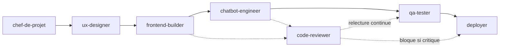

# claude-code-agent-team

**Une équipe de 7 agents Claude Code pour livrer des projets web testés et relus.**

> **In English (3 lines)** — A production pipeline of 7 specialised Claude Code subagents
> (project manager, UX, frontend, chatbot, QA, code review, deploy) that turns a client brief
> into a tested, reviewed website. Install with one script; drive it from a single prompt.

[](LICENSE)


---

## Le problème

Un seul agent IA qui fait tout à la fois dérive : il oublie les contraintes du début de
conversation, saute les tests, et relit son propre code sans recul. Ce dépôt découpe le travail
en **7 agents spécialisés**, chacun avec son propre contexte, ses propres outils et un périmètre
étroit.

## Le flux



Le `chef-de-projet` orchestre : il délègue chaque étape via l'outil `Task` et ne code pas
lui-même. Le `code-reviewer` travaille **en parallèle** du développement, pas à la fin — une
revue qui arrive après les tests coûte trop cher à corriger.

## Les 7 agents

| Agent | Rôle | Quand il intervient | Outils autorisés |
|---|---|---|---|
| `chef-de-projet` | Analyse le brief, découpe, délègue, suit | En premier, et tout du long | `Task`, `TodoWrite`, lecture/écriture |
| `ux-designer` | Sitemap, wireframes textuels, specs d'interface | Avant toute ligne de code | Lecture/écriture, recherche web |
| `frontend-builder` | Intégration HTML/CSS/JS, React, Next.js | Après validation des wireframes | Édition, `Bash`, recherche |
| `chatbot-engineer` | Widget de chat, route API, streaming, persistance | Après la structure frontend | Édition, `Bash`, recherche |
| `qa-tester` | Tests Playwright, responsive, accessibilité, Lighthouse | Avant toute livraison | `Bash`, lecture/écriture |
| `code-reviewer` | Sécurité, qualité, TypeScript strict, bundle | **En parallèle** du développement | Lecture seule + `Bash` |
| `deployer` | Vercel/Netlify, variables d'env, CI/CD, DNS | Seulement si le QA est validé | `Bash`, édition |

Chaque agent a une **liste d'outils restreinte** (champ `tools` de son fichier) : le
`code-reviewer` ne peut pas modifier le code qu'il juge, le `deployer` n'écrit pas de
fonctionnalité.

---

## Installation (3 commandes)

```bash
git clone https://github.com/sofiane779/claude-code-agent-team.git
cd claude-code-agent-team
bash setup.sh
```

Le script vérifie que Claude Code est installé, puis copie les 7 agents dans
`~/.claude/agents/`. Il est **idempotent** : relancé, il met à jour les agents existants.

### Vérifier

Dans Claude Code, tape `/agents` : les 7 agents doivent apparaître.

### Serveurs MCP (facultatif, une seule fois)

```bash
claude mcp add playwright -- npx -y @playwright/mcp@latest
claude mcp add --transport http supabase "https://mcp.supabase.com/mcp?project_ref=<VOTRE_REF>&read_only=true"
```

Un exemple complet est fourni dans [`.mcp.json.example`](.mcp.json.example). Copie-le en
`.mcp.json` (ignoré par Git) et renseigne tes valeurs.
`read_only=true` est volontaire : [la documentation Supabase](https://supabase.com/docs/guides/ai-tools/mcp)
recommande de restreindre le serveur en lecture seule et de le limiter à un seul projet.

---

## Utilisation

Dans un dossier de projet vide, copie `CLAUDE.md` (le modèle de contexte projet), remplis les
champs entre crochets, lance `claude`, puis tape :

```
Nouveau client : cabinet de kinésithérapie, 3 praticiens, besoin d'un site vitrine
4 pages avec prise de rendez-vous et un chatbot qui répond aux questions sur les
horaires et les tarifs. Orchestre l'équipe pour livrer le site.
```

Ce qui se passe ensuite :

1. Le `chef-de-projet` reformule le brief, liste les questions ouvertes et écrit le plan dans `CLAUDE.md`.
2. Il délègue à `ux-designer`, qui rend un sitemap et des wireframes textuels page par page.
3. `frontend-builder` intègre, puis `chatbot-engineer` ajoute la route `/api/chat` et le widget.
4. `code-reviewer` signale les problèmes classés **bloquant / important / suggestion**, chacun avec un correctif concret.
5. `qa-tester` lance Playwright sur 3 largeurs d'écran et rend un rapport de recette avec un verdict.
6. `deployer` ne part en production que si le verdict QA est positif.

> ℹ️ L'exemple ci-dessus est une **démonstration**, pas une mission client réelle.

---

## Choix de conception

- **Un agent = un contexte.** Découper évite qu'un seul fil de conversation sature et perde les
  contraintes posées au départ.
- **Le relecteur est séparé du développeur**, et il est en **lecture seule**. Un agent qui peut
  corriger ce qu'il relit a tendance à relire moins sévèrement.
- **Les outils sont restreints par agent** plutôt que donnés globalement : c'est la barrière la
  plus simple contre une action non souhaitée (un `deployer` qui réécrit du code, par exemple).
- **Le déploiement est conditionné au QA**, écrit dans le prompt de l'agent et pas seulement
  dans une procédure : la règle voyage avec l'agent.
- **`CLAUDE.md` sert de mémoire partagée.** Les décisions y sont consignées, donc elles
  survivent au redémarrage d'une session et sont lisibles par tous les agents.

## Limites connues

- Les 7 agents sont des **prompts**, pas du code : leur qualité dépend du modèle utilisé par
  Claude Code et des outils disponibles dans l'environnement.
- Le kit cible des sites vitrines avec chatbot. Il n'est pas calibré pour une application
  métier complexe.
- Le `setup.sh` écrase les agents de même nom dans `~/.claude/agents/`. Sauvegarde-les si tu les
  as personnalisés.

---

## Auteur

**Sofiane Mameri** — Développeur Fullstack & Intégrateur IA (Claude)

- GitHub : [@sofiane779](https://github.com/sofiane779)
- Malt : [sofianemameri](https://www.malt.fr/profile/sofianemameri)

## Licence

[MIT](LICENSE) — Sofiane Mameri, 2026.
